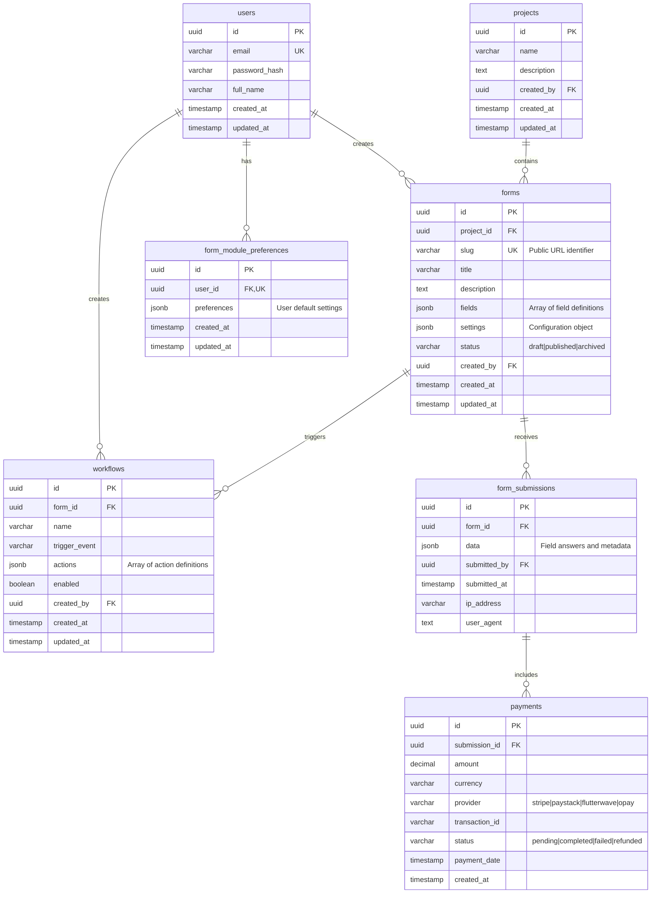
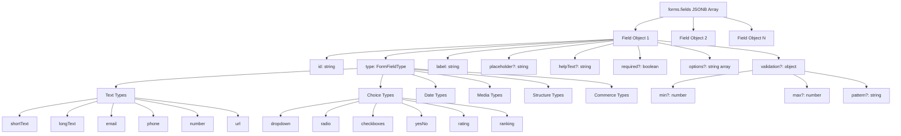
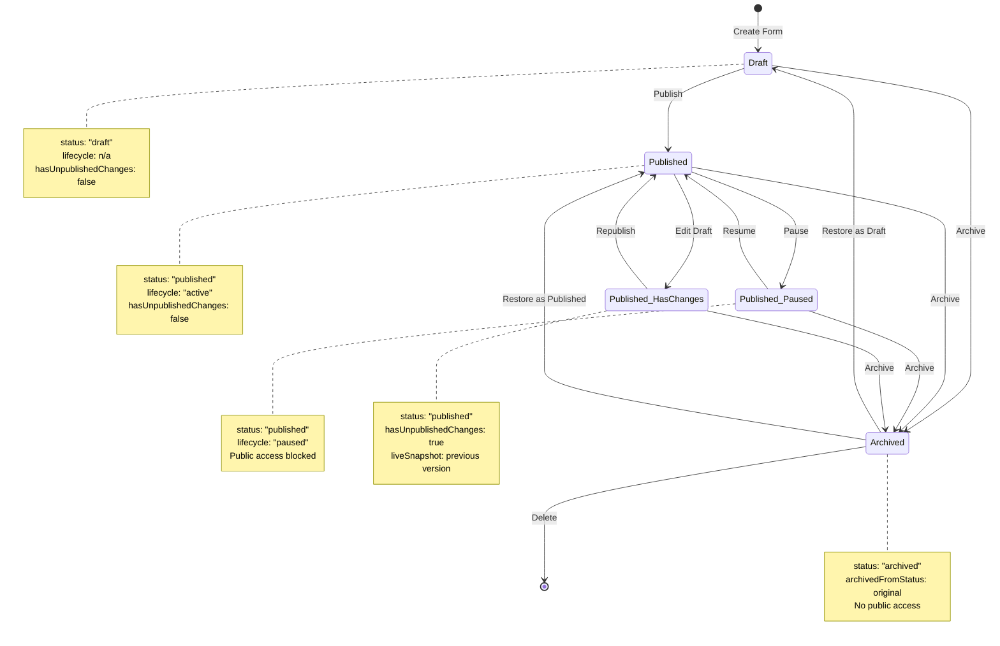
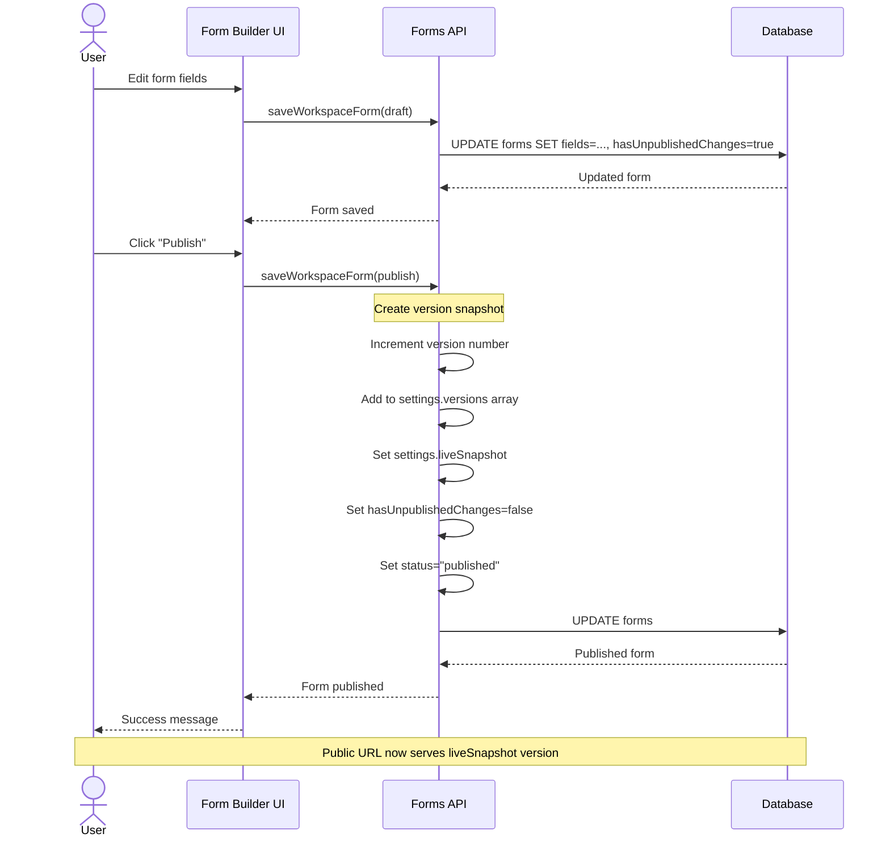
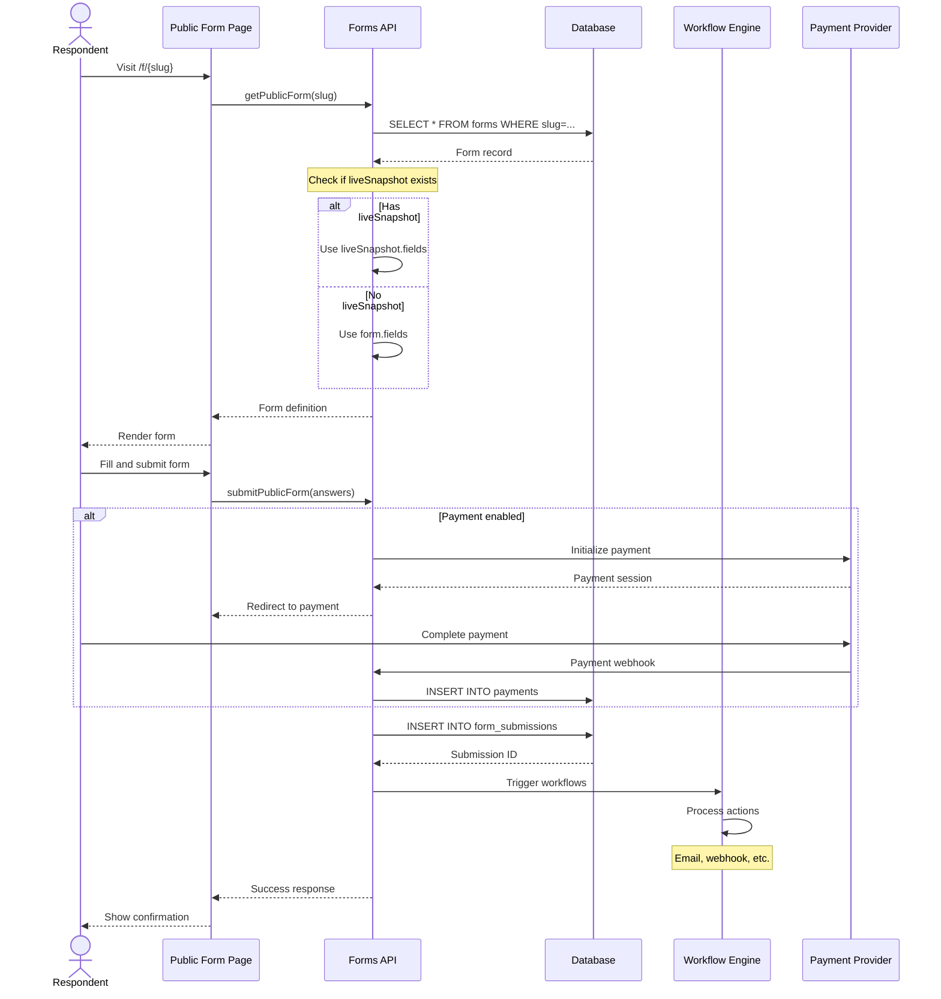
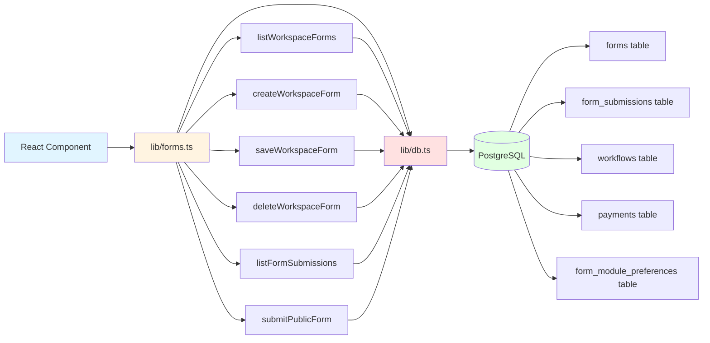
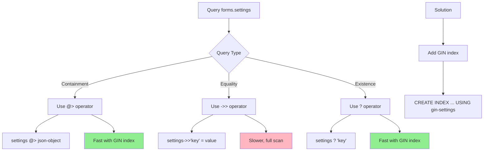
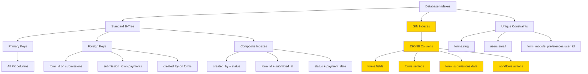
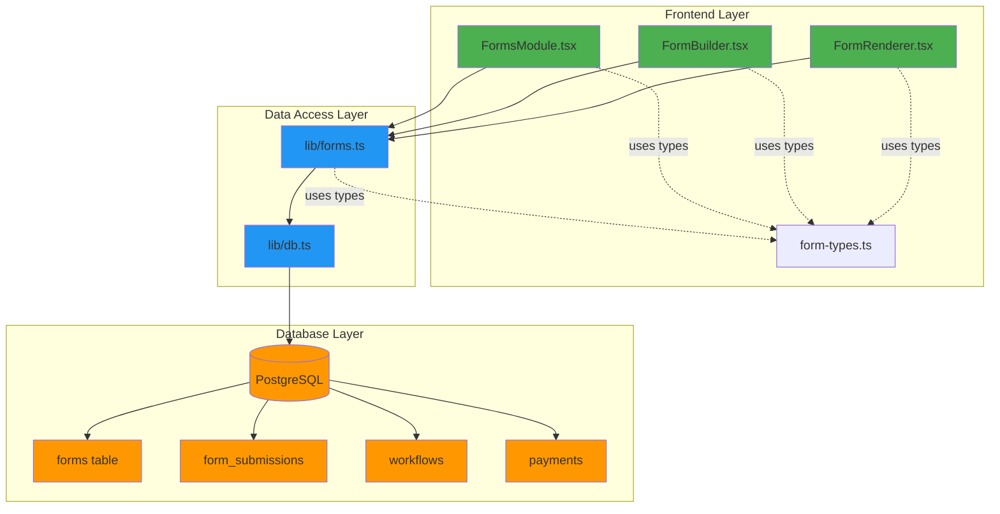

# Form Module Entity-Relationship Diagram

## Complete ER Diagram



---

## Detailed JSONB Structure Diagrams

### forms.fields Array Structure



### forms.settings Object Structure

```mermaid
graph TD
    A[forms.settings JSONB Object] --> B[logic: array]
    A --> C[theme: object]
    A --> D[payment: object]
    A --> E[confirmation: object]
    A --> F[notifications: object]
    A --> G[access: object]
    A --> H[limits: object]
    A --> I[schedule: object]
    A --> J[lifecycle: string]
    A --> K[version: number]
    A --> L[versions: array]
    A --> M[liveSnapshot: object]
    A --> N[hasUnpublishedChanges: boolean]
    
    B --> B1[Logic Rule 1]
    B --> B2[Logic Rule N]
    B1 --> B1A[sourceFieldId]
    B1 --> B1B[operator]
    B1 --> B1C[value]
    B1 --> B1D[action]
    B1 --> B1E[targetFieldId]
    
    C --> C1[accentColor]
    C --> C2[backgroundColor]
    C --> C3[fontFamily]
    C --> C4[fontSize]
    C --> C5[buttonStyle]
    C --> C6[respondentMode]
    
    D --> D1[enabled]
    D --> D2[mode]
    D --> D3[provider]
    D --> D4[amount]
    D --> D5[currency]
    
    G --> G1[mode: public|password|authenticated]
    G --> G2[password: string]
    
    J --> J1[active]
    J --> J2[paused]
```

### form_submissions.data Object Structure

```mermaid
graph TD
    A[form_submissions.data JSONB] --> B["field-uuid-1: value"]
    A --> C["field-uuid-2: value"]
    A --> D["field-uuid-N: value"]
    A --> E["_meta: object"]
    
    E --> E1[status: completed|partial]
    E --> E2[formVersion: number]
    E --> E3[paymentStatus: string]
    E --> E4[referrer: string]
    E --> E5[utm: object]
    
    E5 --> E5A[source]
    E5 --> E5B[medium]
    E5 --> E5C[campaign]
    E5 --> E5D[term]
    E5 --> E5E[content]
```

---

## Form Lifecycle State Diagram



---

## Form Publishing Flow



---

## Form Submission Flow



---

## Data Access Pattern



---

## JSONB Query Performance



---

## Index Strategy



---

## Form Module Architecture



---

## Table Relationship Summary

| Parent Table | Child Table | Relationship | Cascade Delete |
|--------------|-------------|--------------|----------------|
| users | forms | 1:N | No |
| users | form_module_preferences | 1:1 | Yes |
| users | workflows | 1:N | No |
| projects | forms | 1:N | Yes |
| forms | form_submissions | 1:N | Yes |
| forms | workflows | 1:N | Yes |
| form_submissions | payments | 1:N | Yes |

---

## JSONB Column Summary

| Table | Column | Type | Contains |
|-------|--------|------|----------|
| forms | fields | Array | Field definitions with types, validation, options |
| forms | settings | Object | Logic, theme, payment, access, versioning |
| form_submissions | data | Object | Field answers mapped by field ID + metadata |
| workflows | actions | Array | Workflow action definitions |
| form_module_preferences | preferences | Object | User default settings |

---

This ER diagram provides a complete visual representation of the Form Module database schema, showing all relationships, JSONB structures, state flows, and architectural patterns.
